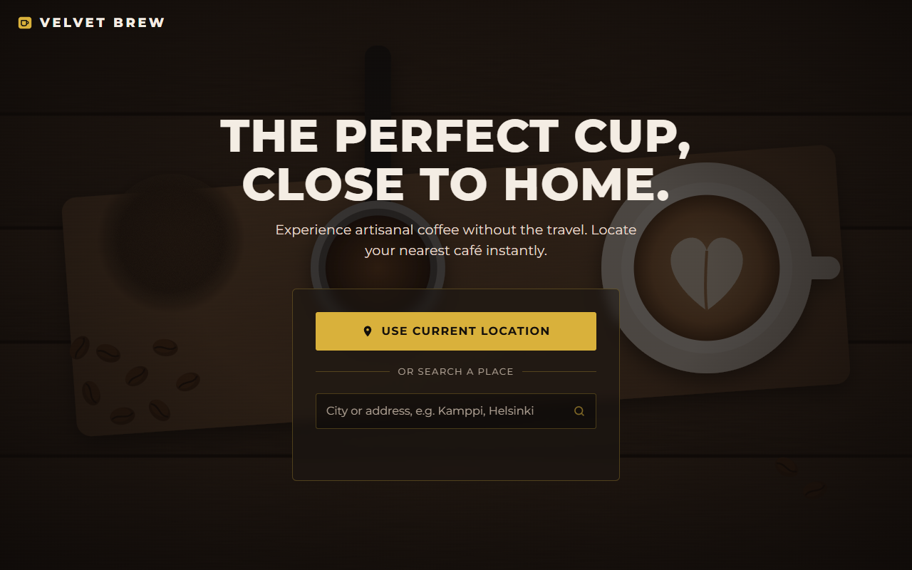
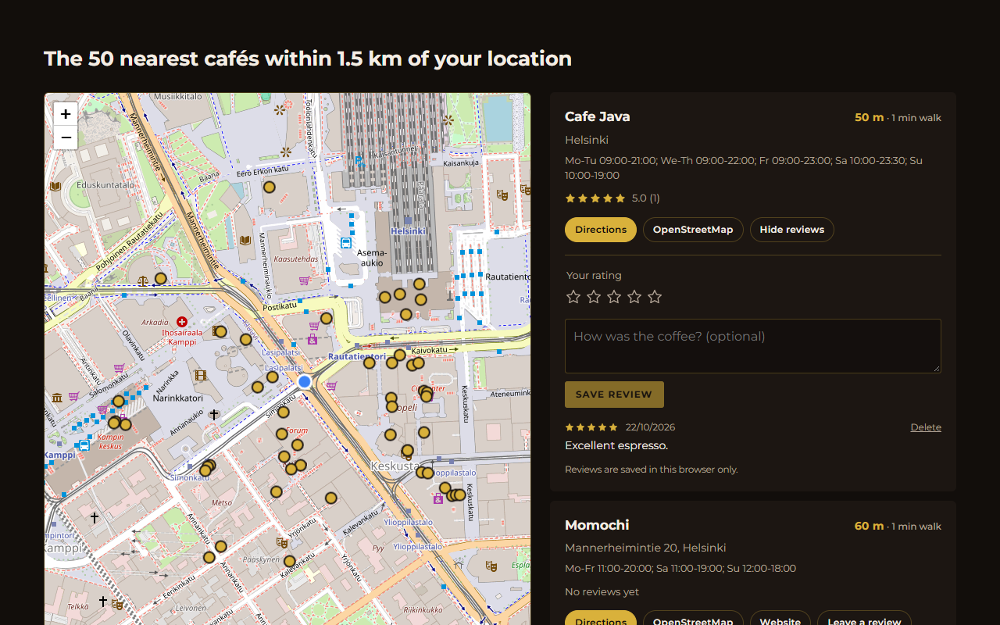
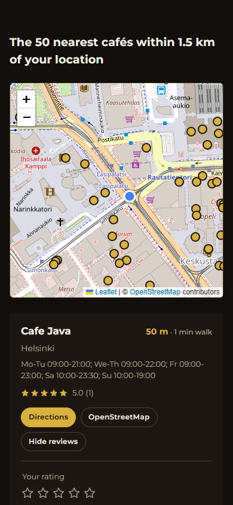

# Velvet Brew: Coffee Finder

A React web app that finds real cafés near you with OpenStreetMap data and shows them on a map and in a list sorted by distance, with walking directions and your own reviews.

**Live demo:** https://kalalev18.github.io/Coffee-Finder/



## The problem

Map apps answer "where is coffee?" with ads, sponsored pins, and a lot of noise. Velvet Brew does one job: show which cafés are closest to where you're standing (or to any place you type), how far each one is on foot, and how to get there. It uses open data only, so it needs no API keys and no account.



<p align="center"></p>

## Features

- **Use current location:** browser geolocation, with clear messages when permission is denied or times out
- **Search a place:** type a city or address (geocoded with Nominatim) when location isn't available
- **Nearest first:** distances calculated with the haversine formula, plus a rough walking time
- **Interactive map:** Leaflet with OpenStreetMap tiles; clicking a pin highlights the matching café in the list, and clicking a café flies the map to it
- **Directions:** one click opens a walking route in Google Maps or OpenStreetMap
- **Café details:** address, opening hours, and website when OpenStreetMap has them
- **Reviews:** rate a café 1 to 5 stars with an optional comment; the average shows on the card. Reviews are stored in your browser's `localStorage` (see [What I would improve next](#what-i-would-improve-next))
- **Fallback servers:** public Overpass servers are often overloaded, so the app tries a list of mirrors in order before showing an error
- **Responsive and accessible:** works down to phone width; keyboard navigation, labelled controls, live status messages, and reduced motion support

## Tech stack

| Area      | Tools                                             |
| --------- | ------------------------------------------------- |
| Front end | React 18, TypeScript (strict), Vite               |
| Map       | Leaflet + react-leaflet, OpenStreetMap tiles      |
| Data      | Overpass API (cafés), Nominatim (address search)  |
| Testing   | Vitest, React Testing Library, jsdom              |
| Quality   | ESLint, Prettier, GitHub Actions CI               |
| Hosting   | GitHub Pages (deployed automatically from `main`) |

## How it works

1. **Find a starting point.** Either `navigator.geolocation` or a Nominatim lookup of the typed place.
2. **Query Overpass** for every `amenity=cafe` node and building within 1.5 km (configurable). Buildings are reduced to their centre point.
3. **Parse and sort.** Unnamed cafés and elements without coordinates are dropped, distances are computed client-side, and the 50 nearest are kept.
4. **Render** the map and list from the same state, so selecting in one updates the other.

A new search cancels any request still in flight (`AbortController`), so a slow earlier response can't overwrite newer results.

## Getting started

Requires **Node.js 20.19+ or 22.12+** (an `.nvmrc` is included).

```bash
git clone https://github.com/KALalev18/Coffee-Finder.git
cd Coffee-Finder
npm ci
npm run dev
```

Open http://localhost:5173. Browsers only allow geolocation on `localhost` or HTTPS, so both the dev server and the live demo work.

### Configuration (optional)

The app works with no configuration. To change the defaults, copy `.env.example` to `.env`:

| Variable               | Default                                      | Purpose                                  |
| ---------------------- | -------------------------------------------- | ---------------------------------------- |
| `VITE_OVERPASS_URLS`   | three public Overpass servers                | Comma-separated servers, tried in order  |
| `VITE_NOMINATIM_URL`   | `https://nominatim.openstreetmap.org/search` | Address search endpoint                  |
| `VITE_SEARCH_RADIUS_M` | `1500`                                       | Search radius in metres (capped at 5000) |

### Other commands

```bash
npm run build      # type-check and build to dist/
npm run preview    # serve the production build locally
npm run check      # lint + format check + type-check + tests (same as CI)
```

## Running tests

```bash
npm test
```

47 tests cover the core logic and the main user flows:

- **Unit:** haversine distance (checked against known distances), distance formatting, Overpass query building and parsing (buildings, unnamed cafés, sorting, result cap), mirror fallback and cancellation, Nominatim geocoding, review storage (including corrupt or blocked `localStorage`), directions URLs, and config parsing
- **Integration (App):** location search, denied permission, typed search, place not found, directions links, saving a review that survives a reload, and map-to-list selection. Network calls and geolocation are mocked; Leaflet is replaced with a stub because jsdom has no layout engine.

The full flow was also checked by hand in Microsoft Edge against the live APIs (Helsinki city centre via geolocation, and "Plovdiv Old Town" via search).

## Project structure

```
src/
├── App.tsx                 # Page layout; connects search state, reviews and results
├── components/
│   ├── Hero.tsx            # Landing section: location button, search form, status
│   ├── Results.tsx         # Results heading, map + list layout, selection state
│   ├── CafeMap.tsx         # Leaflet map with user and café markers
│   ├── CafeCard.tsx        # One café: distance, details, directions, reviews
│   ├── ReviewPanel.tsx     # Star rating form and review list
│   └── Header.tsx, Stars.tsx, Icons.tsx
├── hooks/
│   ├── useCafeSearch.ts    # Locate → fetch → results state machine, cancels stale searches
│   └── useReviews.ts       # Review state synced to localStorage
└── lib/                    # Framework-free logic, unit tested
    ├── overpass.ts         # Query builder, response parser, mirror fallback
    ├── nominatim.ts        # Place search
    ├── geo.ts              # Haversine distance, formatting, walking time
    ├── geolocation.ts      # Promise wrapper around the browser API
    ├── reviews.ts          # Review validation and storage
    ├── directions.ts       # Google Maps / OSM route links
    └── config.ts           # Environment variables with safe defaults
```

## What I would improve next

- **Shared reviews:** reviews currently live in one browser. A small backend (for example Supabase or a Node API with PostgreSQL) would let everyone see them, and would need sign-in and moderation.
- **Filters:** "open now" (by parsing the OSM `opening_hours` format), Wi-Fi, outdoor seating, and vegan options, all already present as OSM tags.
- **Caching:** store recent Overpass results for a few minutes to cut load on the public servers and make repeat searches instant.
- **Adjustable radius** in the UI rather than only through configuration.
- **End-to-end tests** with Playwright in CI, mocking the APIs, to cover the real map.

## Data and credits

- Café and map data © [OpenStreetMap](https://www.openstreetmap.org/copyright) contributors, available under the ODbL.
- Searches use the public [Overpass API](https://wiki.openstreetmap.org/wiki/Overpass_API) and [Nominatim](https://nominatim.org/) within their usage policies: one request per user action and no automated bulk queries.
- Velvet Brew is a made-up brand for this project. The background illustration is an original SVG.

## License

[MIT](LICENSE)
