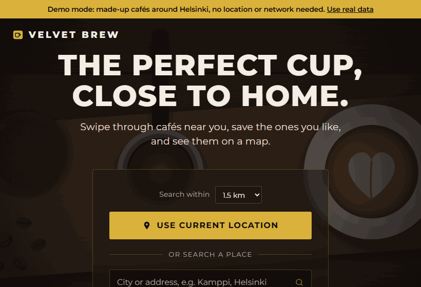
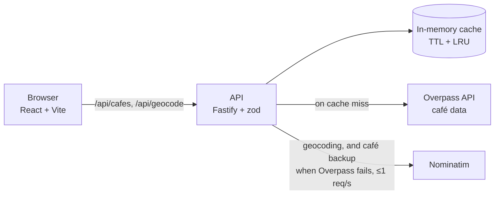

# Personal Coffee Finder

Swipe through cafés near you, save the ones you like, and see them on a map. A React + TypeScript front end and a small Fastify API, running on OpenStreetMap data, so no API keys are involved anywhere.

**Live demo:** https://kalalev18.github.io/Coffee-Finder/ · [demo mode with sample data](https://kalalev18.github.io/Coffee-Finder/?demo)



## Features

- Search from your location or a typed address, within 500 m to 5 km
- Swipe cards: drag right to save, left to skip, with undo. Works with touch, mouse and keyboard (← → and Backspace)
- "Open now" filter, based on a parser for OpenStreetMap's `opening_hours` format
- Map and list in sync, walking directions, and personal 1–5 star reviews
- Saved cafés are kept in the browser and shown on their own map
- Demo mode (`?demo`) with bundled sample data, for trying it without location access or network

## Architecture



```
apps/web         React front end (swipe deck, map, filters, saved list)
apps/api         Fastify API: validation, caching, rate limiting, metrics
packages/shared  Types and OpenStreetMap query/parse logic used by both
```

The front end picks its data source at build time: the API (`VITE_API_URL`), the OpenStreetMap services called directly from the browser (the static GitHub Pages build), or bundled demo data.

## Design decisions

**Why an API when there's no key to hide.** The original template exposed a Google key in front-end code. Switching to OpenStreetMap removed the secret, but the public servers are shared and rate-limited. The API caches results for all users, rate-limits per IP (30/min), spaces Nominatim calls to the one per second its policy allows, and sends an identifying `User-Agent`, which browsers don't let scripts set.

**Caching nearby searches.** Two people a few metres apart would never share an exact-coordinate cache key. Each search is snapped to the centre of a ~280 m grid cell. The upstream query uses a radius padded by 200 m, which covers the worst-case snapping error, so no café is missed. Distances are then measured from the real origin. Concurrent requests for the same cell share one upstream call, and failed calls are never cached.

**When Overpass is down.** Public Overpass mirrors often return 429/504 or simply hang. Each mirror gets 8 s, with a 15 s budget for all of them. After that the search falls back to Nominatim's place search. The fallback returns at most 40 cafés with fewer details, and the page says when it's being used. A newer search aborts the previous one, so a slow old response can't overwrite new results.

**The swipe gesture.** It uses Pointer Events with pointer capture, so one code path covers touch and mouse. The drag offset is written to a CSS custom property rather than React state, so the card moves without re-rendering on every event. A card counts as saved or skipped past 100 px, or with a fast flick. `touch-action: pan-y` keeps vertical scrolling working on phones. With `prefers-reduced-motion`, decisions apply instantly.

**Untrusted data.** OpenStreetMap is user-edited, so website links are only rendered if they parse as `http(s)` URLs. Text is escaped by React. All API input is validated with zod.

## Measured results

Lighthouse 13.5.0 on the production build (demo mode, local preview, 26 Oct 2026):

| Preset  | Performance | Accessibility | Best practices | SEO | LCP   |
| ------- | ----------- | ------------- | -------------- | --- | ----- |
| Mobile  | 94          | 100           | 100            | 100 | 2.3 s |
| Desktop | 98          | 100           | 100            | 100 | 0.7 s |

Geocoding through the API (`npm run bench -w @coffee-finder/api -- geocode`, three places looked up three times each with different casing): 6 of 9 requests were cache hits answered in 1–3 ms, against 506–970 ms for a miss. A miss includes the one-request-per-second spacing.

The café search uses the same cache. I haven't benchmarked it against live Overpass yet, because the public servers were timing out when I tried, so I claim no numbers for it. That outage is also why the Nominatim fallback exists: during it, a search from central Helsinki returned 39 cafés through the backup after 16.4 s. `npm run bench -w @coffee-finder/api -- cafes` measures the cache.

## Getting started

Requires Node.js 20.19+ or 22.12+.

```bash
git clone https://github.com/KALalev18/Coffee-Finder.git
cd Coffee-Finder
npm ci
npm run dev                  # front end on http://localhost:5173, calling OpenStreetMap directly
```

To run the full stack, create `apps/web/.env` containing `VITE_API_URL=http://localhost:3001`, then:

```bash
npm run dev:api              # API on http://localhost:3001 (second terminal)
npm run dev
```

Nothing needs configuring. The options are listed in [`apps/web/.env.example`](apps/web/.env.example) and [`apps/api/.env.example`](apps/api/.env.example). The API ships as a Docker image (`docker build -f apps/api/Dockerfile .`), with a [Render blueprint](render.yaml) included.

## Testing

```bash
npm run check                # lint, format, type-check and all unit/integration tests
npm run test:e2e             # Playwright, desktop and mobile viewports
```

- **118 unit and integration tests (Vitest).** They cover the opening-hours parser, swipe thresholds, grid snapping, the TTL/LRU cache, Overpass parsing, failover and the Nominatim fallback, API routes through `fastify.inject` with mocked upstreams (validation, 502s, rate limits, CORS, metrics), and app flows in React Testing Library.
- **4 Playwright scenarios, each run on desktop and mobile.** They cover search → swipe → save → map in demo mode, a typed search with mocked OpenStreetMap responses, the denied-location fallback, and an axe scan for WCAG 2.1 AA violations.

CI runs all of this on every push, and also builds the API's Docker image.

## Background

This started as the [Codédex](https://www.codedex.io/) Cafe Finder template, a single HTML/JS page that called Google Places with an API key in the page source, through a public CORS proxy. I rewrote it from scratch. None of the template code remains. I replaced Google with OpenStreetMap so there's no key to leak, added the API, the swipe deck and filters, and added tests and CI.

## Next steps

- Shared reviews and saved lists, using a database and sign-in
- Redis instead of the in-memory cache, so several API instances share it
- Photos (OpenStreetMap has none; Wikimedia Commons links are one option)

## Credits and license

Map and café data © [OpenStreetMap](https://www.openstreetmap.org/copyright) contributors (ODbL). The demo cafés are invented. MIT licensed, see [LICENSE](LICENSE).
